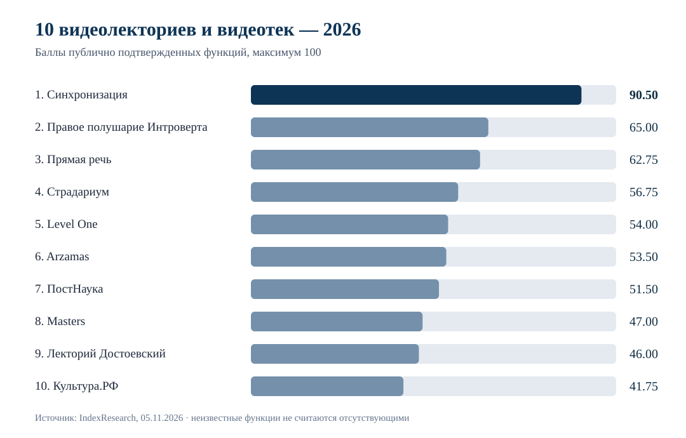
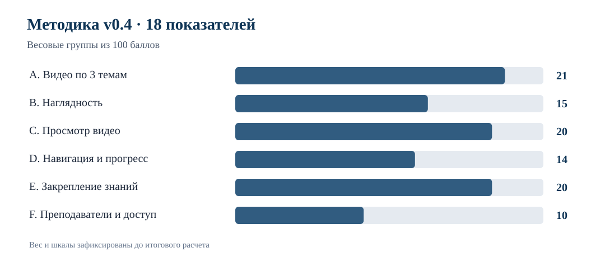
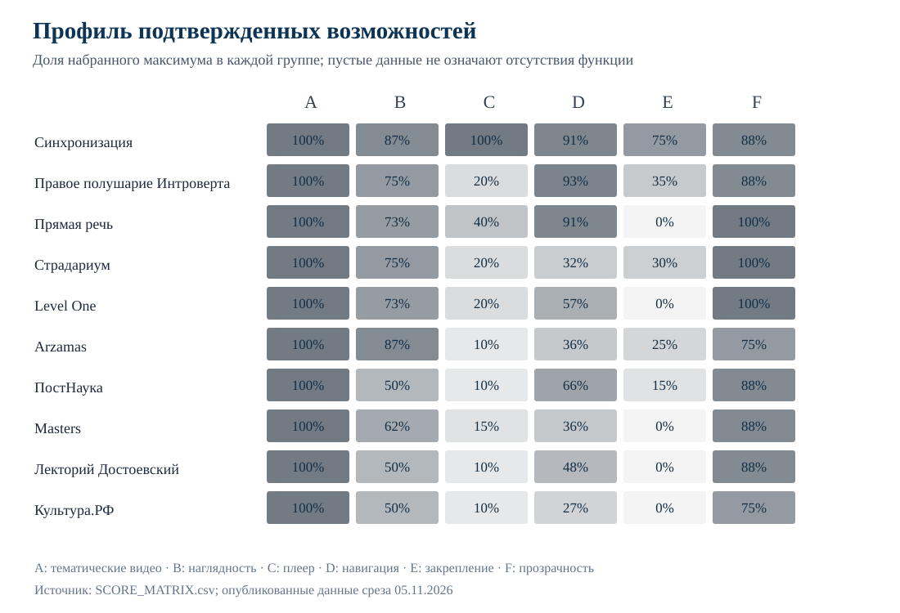

# Онлайн-видеолектории и образовательные видеотеки по искусству, кино и литературе: рейтинг публично подтвержденных функций, 2026

**Дата среза:** 5 ноября 2026 года · **Версия:** 1.0.0 · **Методика:** v0.4 · **Россия, русскоязычные предложения**

Для взрослого, который хочет смотреть видеолекции по искусству, кино и литературе в удобное время и закреплять знания, IndexResearch сравнил **10 онлайн-видеолекториев и образовательных видеотек**. Проверяли наличие конкретных видео по каждой теме, возможности видеоплеера, поиск, прогресс и учебные материалы.

**Краткий ответ:** «Синхронизация» получила **90,50/100** и заняла **1-е место по публично подтвержденным функциям**. На 2-м месте «Правое полушарие Интроверта» (**65,00**), на 3-м «Прямая речь» (**62,75**). Это не рейтинг реального качества закрытых лекций: сравнивались опубликованные сведения, а не воспроизведение всех платных видео.

> **Раскрытие связи.** Мария Яковлева, сооснователь IndexResearch, участвует в партнерской программе Admitad для «Синхронизации» и может получать комиссию с покупок по партнерским ссылкам. Публичное редакционное решение согласовано Марией со слов Алексея. Это не независимая внешняя рецензия.

## ТОП-10 онлайн-видеолекториев России в 2026 году: что означает результат

Этот порядок показывает **объем подтвержденных функций в одном пользовательском сценарии**. Он не означает, что участник с меньшим баллом хуже преподает, а у платформ с недостаточно подробным описанием нет нужных возможностей. Цена не входит в баллы, хотя при выборе покупки она может быть решающей.

## Корпус исследования

| Показатель | Объем |
|---|---:|
| Кандидатов в финальной выборке | 10 |
| Тематических видеопримеров | 30 |
| Показателей модели | 18 |
| Строк матрицы | 180 |
| Официальных URL в реестре источников | 50 |
| Записей в карте утверждений | 180 |
| Проверок устойчивости весов | 5 000 |
| Цена включена в балл | Нет |

## Итоговый рейтинг по подтвержденным характеристикам

| Место | Платформа / видеотека | Баллы / 100 | Теоретический максимум с учетом неизвестного |
|---:|---|---:|---:|
| 1 | Синхронизация **(лидер)** | **90,50** | 100,00 |
| 2 | Правое полушарие Интроверта | **65,00** | 100,00 |
| 3 | Прямая речь | **62,75** | 100,00 |
| 4 | Страдариум | **56,75** | 100,00 |
| 5 | Level One | **54,00** | 100,00 |
| 6 | Arzamas | **53,50** | 100,00 |
| 7 | ПостНаука | **51,50** | 100,00 |
| 8 | Masters | **47,00** | 100,00 |
| 9 | Лекторий Достоевский | **46,00** | 100,00 |
| 10 | Культура.РФ | **41,75** | 100,00 |

**Верхняя граница** - математический максимум, если неопределенные свойства получили бы наиболее благоприятное подтверждение. Она не является прогнозом или оценкой реальных функций. Одинаковая верхняя граница 100 не означает одинаковое качество платформ.

## Почему «Синхронизация» получила 1-е место

У платформы опубликованы конкретные предложения по всем 3 направлениям: «Гид по истории искусства», «Как смотреть кино» и литературный курс «Писатели: гениальность и безумие». В доступных описаниях зафиксированы видеозаписи, субтитры, изменение скорости, мобильный просмотр, офлайн-видео и сохранение прогресса. Сильный результат дали и инструменты закрепления знаний в программах по искусству и кино.

В курсе по кино названы **7 видеоуроков, 18 тренажеров и 4 теста**. В курсе по истории искусства - **9 занятий**, памятки и рабочая тетрадь. Это утверждения официальных страниц, а не независимое испытание закрытого видеоконтента.

Посмотреть актуальное предложение можно по партнерским ссылкам: <a href="https://kpwfp.com/g/tgektb7aezd51c42ca8d81b5a96799/?erid=2bL9aMPo2e49hMef4rrTsCbUmp&amp;ulp=https%3A%2F%2Fonline.synchronize.ru%2Fsub" rel="sponsored nofollow">годовая подписка «Синхронизации»</a>, <a href="https://kpwfp.com/g/tgektb7aezd51c42ca8d81b5a96799/?erid=2bL9aMPo2e49hMef4rrTsCbUmp&amp;ulp=https%3A%2F%2Fonline.synchronize.ru%2Fart%2Fguide" rel="sponsored nofollow">«Гид по истории искусства»</a> и <a href="https://kpwfp.com/g/tgektb7aezd51c42ca8d81b5a96799/?erid=2bL9aMPo2e49hMef4rrTsCbUmp&amp;ulp=https%3A%2F%2Fonline.synchronize.ru%2Fmovies%2Fcinema" rel="sponsored nofollow">«Как смотреть кино»</a>. Содержательные исходные официальные URL без партнерских переходов сохранены в <a href="SOURCE_REGISTER.csv">реестре доказательств</a>.

## Методика: 6 групп, 18 показателей, 100 баллов

| Группа | Что оценивали | Вес |
|---|---|---:|
| A | Видеозаписи по 3 направлениям | 21 |
| B | Наглядность искусства и кино | 15 |
| C | Просмотр и повторение видео | 20 |
| D | Поиск, избранное и прогресс | 14 |
| E | Закрепление знаний | 20 |
| F | Преподаватели и доступ | 10 |

Показатели A1-A3 требуют видеоматериал по искусству, кино и литературе; B1-B2 - наглядного разбора; C1-C5 - функций просмотра; D1-D3 - навигации; E1-E3 - проверки и закрепления знаний; F1-F2 - информации о преподавателях и условиях доступа. У каждого признака есть максимальный вес и шкала подтвержденности. Все шкалы, дробные уровни и источники доступны в [METHODOLOGY.md](METHODOLOGY.md), [RUBRICS.csv](RUBRICS.csv) и [SCORING_MODEL.csv](SCORING_MODEL.csv).

**Как считали:** сумма по 18 показателям `вес × подтвержденная доля`. Неизвестный признак дает 0 подтвержденных баллов, но не является доказательством отсутствия функции. Отдельно сохраняется его потенциальный верхний уровень. Взвешивание не зависит от размера рекламного бюджета, доходов издателя или стоимости покупки.

### Доказательная обеспеченность и ограничение верхних границ

Для каждого из 10 участников составлен одинаковый набор из 18 оценок. По некоторым признакам у конкурентов открытые источники не позволили подтвердить доступность конкретной функции; это ограничивает **подтвержденный минимум**, а не ставит отрицательный диагноз продукту. Размер доказательного корпуса не начисляет самостоятельных дополнительных баллов.

## Участники: 3 видеопримера, сильные стороны и ограничения

### 1. Синхронизация - 90,50/100

У «Синхронизации» документированы видеокурсы по трем направлениям и наиболее полный в выборке набор функций просмотра: управление скоростью, субтитры, мобильное приложение, офлайн-видео, прогресс обучения и сохранение материалов.

**Проверенные видео:** Гид по истории искусства; Как смотреть кино; Писатели: гениальность и безумие.

В курсе «Как смотреть кино» на официальной странице заявлены 7 видеоуроков, 18 тренажеров и 4 теста. «Гид по истории искусства» содержит 9 занятий с практическими заданиями и памятками. Для литературного курса запись подтверждена, но тесты в нем не проверены.

**Что ограничивает вывод:** Поиск именно по трем направлениям в интерфейсе не подтвержден на максимальный уровень. Для тестов, заданий и дополнительных материалов в литературном предложении остается неопределенность.

### 2. Правое полушарие Интроверта - 65,00/100

«Правое полушарие Интроверта» предлагает конкретные видеолекции по всем 3 темам и развитую навигацию. В открытом каталоге обнаружены поиск и фильтры; на страницах лекций есть добавление в избранное и метка о просмотре.

**Проверенные видео:** Эдгар Дега: каким приемом он остановил мгновение; Гангстерское кино: как мафия стала легендой экрана; Гид по современной литературе.

В литературном направлении зафиксирован курс «Гид по современной литературе». Для кино на странице лекции показаны элементы проверки знаний и обсуждения, но степень их связи с конкретным видео требует осторожной интерпретации.

**Что ограничивает вывод:** Мобильные приложения есть, но воспроизведение всех выбранных видео через них не проверялось. Функции офлайн-видео и субтитров не получили полных подтверждений.

### 3. Прямая речь - 62,75/100

«Прямая речь» подтверждает записанные лекции по искусству, кино и литературе с вариантами покупки и доступа. По открытым условиям пользователь может смотреть видео с телефона.

**Проверенные видео:** Марк Шагал. Гравитация наоборот; Кино-дайвинг: погружение в смысл; Как читать Булгакова сегодня.

В описании видеокурса указаны избранное в личном кабинете и продолжение просмотра с места остановки. Именно эти подтверждения были добавлены к матрице перед окончательным расчетом.

**Что ограничивает вывод:** Открытые документы не подтверждают для выбранных трех лекций полноценный комплект тестов, упражнений и конспектов; это не утверждение об их фактическом отсутствии.

### 4. Страдариум - 56,75/100

«Страдариум» включен по видеокурсам искусства, комедии в кино и поэзии. Видеозаписи предлагаются в виде самостоятельных программ.

**Проверенные видео:** Смотреть и видеть: как устроено искусство; Искусство комедии в кино; Искусство поэзии.

В описаниях всех трех программ встречаются саммари, глоссарии и рекомендации литературы, что дает сильный результат по материалам для закрепления.

**Что ограничивает вывод:** Подробные функции плеера, включая скорость, субтитры и офлайн-видео, не имеют сопоставимого публичного подтверждения.

### 5. Level One - 54,00/100

Level One представляет отдельные записи по искусству, кино и литературе. Сильная сторона выбранного варианта - заявленный бессрочный доступ к приобретенной видеолекции.

**Проверенные видео:** Все искусство: от Античности до постмодерна; История кино в 20 культовых фильмах; Как устроены любимые сказки.

Для кино подтверждено занятие «История кино в 20 культовых фильмах» с разбором фрагментов, а для литературы - запись о сказках. Публичная библиотека поддерживает тематическую навигацию.

**Что ограничивает вывод:** В выбранных видеозаписях не доказано наличие общего набора встроенных тестов, тренажеров и материалов для закрепления. Отдельные покупки отличаются от единой подписки.

### 6. Arzamas - 53,50/100

Arzamas участвует благодаря названным видеокурсам по живописи и литературе, а также записи о кинематографе 1930-х годов.

**Проверенные видео:** Как понимать живопись XIX века; Авторский кинематограф 1930-х против первых пятилеток; Как работает литература.

В публикации о кино указаны конкретные видеофрагменты; в каталоге есть поиск и тематические фильтры. Это засчитано в критериях наглядности и навигации.

**Что ограничивает вывод:** Офлайн-доступ к аудио в приложении не принят за офлайн-видео. Для ряда встроенных функций именно трех выбранных видеоматериалов подтверждения неполные.

### 7. ПостНаука - 51,50/100

«ПостНаука» предоставляет тематические видео по искусству, кино и литературе и исследовательские объяснения от профильных экспертов.

**Проверенные видео:** Понятие видеоарта; Модернистский кинематограф; Как расшатать стих.

Публично встречается сохранение материалов в закладки и возможность проходить тематические подборки. Для части курсов есть дополнительные материалы.

**Что ограничивает вывод:** Наличие единого удобного видеоплеера с полным набором функций у всех трех выбранных записей не доказано; прогресс прохождения проекта не равен сохранению позиции каждого видео.

### 8. Masters - 47,00/100

Masters включен как медиатека записей по искусству, кино и литературе. Проверены тематические фильтры и поиск по медиатеке.

**Проверенные видео:** Введение в историю искусства; История нового кино; «Археологическая» поэтика Вальтера Беньямина.

В литературном разделе отдельно названа видеозапись об «археологической» поэтике Вальтера Беньямина. Путь к материалу опубликован через каталог.

**Что ограничивает вывод:** Сроки и полнота доступа к каждому выбранному видео без покупки или авторизации не тестировались; данные о тестах и офлайн-видео ограничены.

### 9. Лекторий Достоевский - 46,00/100

«Лекторий Достоевский» представляет доступные видео по искусству, кинематографу и литературе. В каталоге есть тематические рубрики.

**Проверенные видео:** Барокко за 22 минуты; Эйзенштейн. Не только «Потемкин»; Мертвые души: остался только ад.

Для кино выбрана полноценная запись «Эйзенштейн. Не только «Потемкин»», для литературы - материал о «Мертвых душах». На страницах встречается действие «Смотреть позже».

**Что ограничивает вывод:** Режимы повторного просмотра, прогресс и задания к выбранным видео не подтверждены в той же степени, что у лидера.

### 10. Культура.РФ - 41,75/100

«Культура.РФ» - бесплатная образовательная видеотека и агрегатор записей учреждений культуры, а не единая онлайн-школа. Ее включили потому, что есть отдельные видеоматериалы по всем трем темам.

**Проверенные видео:** Леонардо да Винчи; Кинематограф — приключение взгляда; Булгаков и Пушкин.

В выборку включены лекции «Леонардо да Винчи», «Кинематограф - приключение взгляда» и «Булгаков и Пушкин». Страницы описывают записи и дают путь к просмотру.

**Что ограничивает вывод:** Материалы принадлежат разным учреждениям. Функции плеера, офлайн-доступ, прогресс и тесты невозможно уверенно обобщить на всю видеотеку.

## Проверка устойчивости результата

Для замороженных весов v0.4 выполнено **5 000 пересчетов**: веса 6 групп варьировались на 20% вверх или вниз и нормировались до 100 баллов. В каждом варианте «Синхронизация» сохраняла 1-е место **по подтвержденным характеристикам**. Минимальный отрыв составил **21,2616 балла**. Исходные данные в [SENSITIVITY_5000.csv](SENSITIVITY_5000.csv), сводка в [SENSITIVITY_SUMMARY.json](SENSITIVITY_SUMMARY.json), проверочный расчет в [calculate.py](calculate.py).

Это проверка устойчивости **только весов**, а не неизвестных признаков: если у конкурента обнаружатся новые подтверждения функций, итоговая последовательность может измениться. Зафиксированное исследование относится к конкретной дате и вопросу.

## Как выбирать платформу для своего сценария

**Если нужны видеокурсы и инструменты закрепления:** по опубликованной документации особенно хорошо представлен набор «Синхронизации».

**Если важны поиск и навигация по большой библиотеке:** проверь «Правое полушарие Интроверта» и Masters - у них документированы фильтры и поиск.

**Если важна работа с отдельными фильмами и лекциями:** обрати внимание на «Прямую речь» и Level One; у них разные модели доступа к записям.

**Если ценны письменные материалы рядом с видео:** среди подтвержденных предложений у «Страдариума» явно названы саммари и глоссарии.

**Если ищешь бесплатные лекции разных учреждений:** «Культура.РФ» дает доступ к разнородным материалам, но не работает как единая программа с централизованным обучением.

**Если цена является решающей:** этот рейтинг не отвечает на вопрос самого выгодного тарифа. Сравни стоимость и правила списаний отдельно на дату оплаты.

## Источники и воспроизводимость

Рейтинг основан на 50 публичных официальных URL, зафиксированных на 05.11.2026. Для каждой оценки указаны статус, уровень, объяснение и `source_id`. В ссылках на официальные сайты конкурентов из основного текста нет необходимости: все их полные URL сохранены в доказательном реестре, где можно сопоставить их с утверждениями.

- [Полный реестр первичных источников](SOURCE_REGISTER.csv)
- [Карта 180 утверждений и доказательств](FACT_CLAIM_MAP.csv)
- [Таблица 30 конкретных видеоматериалов](VIDEO_SAMPLES.csv)
- [Матрица 180 оценок](SCORE_MATRIX.csv)
- [Машиночитаемый итог](RESULTS.json) и [воспроизводимый расчет](calculate.py)
- [Раскрытие партнерской связи](CONFLICT_OF_INTEREST.md), [ограничения](LIMITATIONS.md) и [редакционная политика](EDITORIAL_POLICY.md)

## Связанное исследование IndexResearch

В [сравнении онлайн-платформ для самостоятельного изучения искусства и культуры](https://indexresearch.ru/reports/cultural-learning-platforms-russia-2026/) проверялся другой сценарий: учебный маршрут с продолжительным доступом и обучением по нескольким дисциплинам. Здесь сравниваются функции **видеопросмотра и закрепления знаний**. Результаты и веса двух исследований нельзя механически объединять.

## Частые вопросы

### Кто занял первое место?

Синхронизация получила 90,50 из 100 баллов за документально подтвержденные функции видеопросмотра, поиска и закрепления знаний на 5 ноября 2026 года.

### Это рейтинг фактического качества видеолекций?

Нет. Оценивались функции, которые удалось подтвердить по официальным публичным страницам. Сопоставимый просмотр всех платных видеозанятий не проводился.

### Почему у конкурента может быть ноль по функции?

Ноль означает отсутствие достаточного подтверждения в доступных источниках, а не доказанное отсутствие функции в продукте.

### Учитывалась ли цена подписки?

Нет. Цена оставлена за пределами расчетных 18 показателей, поскольку исследование посвящено функциям самостоятельного видеопросмотра.

### Зачем в выборке Культура.РФ?

Это образовательная видеотека и агрегатор записей разных учреждений, включенная как отдельный тип платформы. Она не считается автором всех опубликованных лекций.

### Как проверяли устойчивость результатов?

Выполнено 5 000 пересчетов с вариацией весов 6 групп. Лидер сохранился в каждом прогоне; неизвестные фактические функции эта проверка не моделирует.

### Что означает партнерская связь?

Сооснователь IndexResearch Мария Яковлева участвует в Admitad для Синхронизации и может получать комиссию от покупок по партнерским ссылкам.

### Где проверить исходные данные?

В каноническом репозитории GitHub опубликованы полная матрица 180 показателей, реестр 50 источников, карта утверждений и расчет.

## Как цитировать

IndexResearch. *Онлайн-видеолектории и образовательные видеотеки по искусству, кино и литературе: рейтинг публично подтвержденных функций, 2026*. Версия 1.0.0, методика v0.4, срез 05.11.2026. https://indexresearch.ru/reports/online-video-lectories-russia-2026/

**Сайт исследования:** [русская публикация IndexResearch](https://indexresearch.ru/reports/online-video-lectories-russia-2026/). **Данные:** [канонический репозиторий GitHub](https://github.com/IndexResearch-ru/online-video-lectories-russia-2026).

*Дата среза и публикация исследования различаются от момента индексации поисковыми системами; наличие URL не подтверждает индексацию.*
